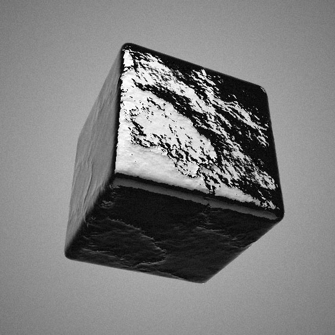

# Spherical Environment Mapping (MatCap/LitSphere) and Normal Mapping

Spherical Mapping (MatCap/LitSphere) with Normal Mapping, using WebGL and GLSL. An editor to toy around with different materials, normals and render effects, with subdivision, noise and rim lighting.

#### Demo ####
- **[Spherical Normal Mapping](https://spite.github.io/spherical-normal-mapping/)**: pick a matcap, a normal map and a model on the panel on the right, or drop your own images on it. Drag to rotate, scroll or pinch to zoom

#### 2026 update ####
**Disclaimer:** this demo is from 2013, and was only on clicktorelease.com until now. three.js has had this built in since r96 (2018): [`MeshMatcapMaterial`](https://threejs.org/docs/pages/MeshMatcapMaterial.html) shades with a matcap, and takes a `normalMap` and a `bumpMap`. Use that one in a project. This page is the editor to try matcaps and normal maps on, and the shader shows how it works

The page has been rewritten for current three.js. What changed:

- it runs on three.js r186, from a CDN with an import map. It was on r58
- the subdivision is [three-subdivide](https://github.com/stevinz/three-subdivide), the modifier that three.js had is gone
- the head is the glTF one from the three.js examples, it was a 1.2 MB JSON file in a format three.js no longer reads
- the normal map uses tangents worked out in the shader, from how the texture coordinates change across the screen, instead of tangents computed for each model
- the blob is smooth across the edges of the box it's made from
- the background is drawn behind the scene, it was a sphere around the camera
- dragging uses pointer events, two fingers zoom, and zooming has limits
- the camera moves at the same speed at any refresh rate
- the sliders change things as they move, not only when they're released
- the drop boxes can also be clicked to pick a file, and any image works. They resized images that weren't a power of two, which isn't needed anymore
- Snapshot downloads the picture on the first click, it took two
- Fullscreen uses the standard API, and Antialiasing renders at twice the pixel ratio
- it's sharp on screens with more than one pixel per point
- the Facebook, Twitter and Google+ buttons are gone, and so are the scripts and textures that weren't used

#### License ####

MIT licensed

Copyright (C) 2013 Jaume Sanchez Elias, http://www.clicktorelease.com

The matcaps and normal maps are owned by their respective owners (LitSphere from polycount.com, Luxology, etc.). Lee Perry-Smith's head is by [Infinite Realities](https://ir-ltd.net/), from the three.js examples.
